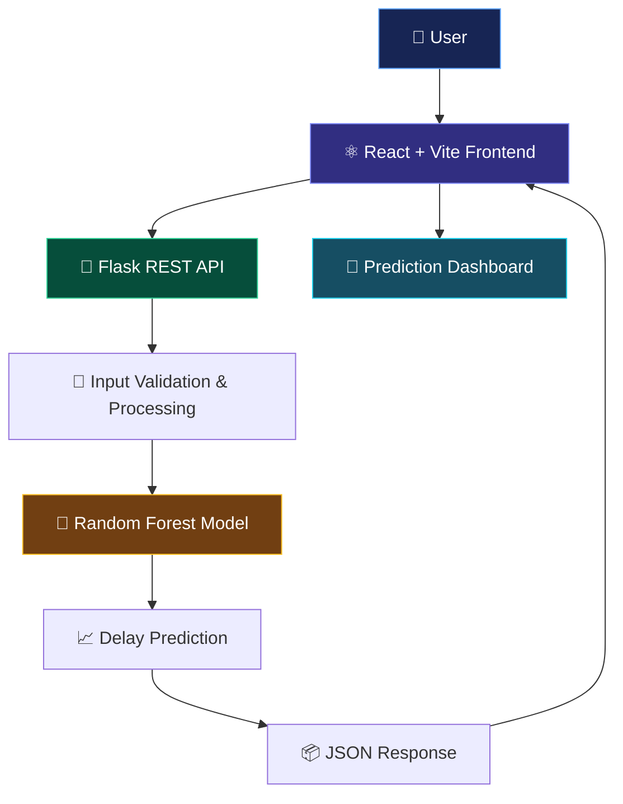

# 🚆 TransitIQ — Public Transport Delay Prediction

<div align="center">


<br/>

**An End-to-End Machine Learning Web Application**

Predict estimated public transport arrival delays using machine learning and an interactive web interface.

<br/>

<a href="https://vedanthpatil1706.github.io/public-transport-delay-prediction/">
  
</a>
<a href="https://github.com/vedanthpatil1706/public-transport-delay-prediction">
  
</a>

<br/><br/>


</div>

---

## 🌟 About The Project

**TransitIQ** is a machine learning-powered web application designed to estimate public transport arrival delays.

The project combines data science, machine learning, backend API development, and frontend engineering into one deployed application.

Users can enter transport, schedule, weather, and event-related information through an interactive dashboard and receive an estimated arrival delay.

> 💡 From data preprocessing to a live web application — TransitIQ demonstrates an end-to-end machine learning workflow.

## ✨ Key Features

- 🚆 **Delay Prediction:** Estimates arrival delays using a trained Random Forest regression model.
- 🌦️ **Multiple Input Features:** Uses transport, schedule, weather, and event-related information.
- ⚡ **Interactive Dashboard:** Clean and responsive React-based interface.
- 🧠 **Machine Learning Integration:** Connects a serialized Scikit-learn model to a Flask API.
- 🔗 **REST API:** Handles prediction requests and returns structured JSON responses.
- ☁️ **Cloud Deployment:** Frontend hosted on GitHub Pages and backend deployed on Render.
- 📊 **Instant Results:** Displays estimated delay and an On Time / Delayed status.

## 🖥️ Live Application

<div align="center">

### Experience TransitIQ in action!

<a href="https://vedanthpatil1706.github.io/public-transport-delay-prediction/">
  
</a>

</div>

## 🏗️ System Architecture



## 🧰 Tech Stack

| Category | Technologies |
|---|---|
| Frontend | React.js, Vite, CSS |
| Backend | Python, Flask, Flask-CORS |
| Machine Learning | Scikit-learn, Random Forest Regressor |
| Data Processing | Pandas, NumPy |
| Model Serialization | Joblib |
| API Communication | REST API, JSON |
| Frontend Deployment | GitHub Pages |
| Backend Deployment | Render |
| Version Control | Git, GitHub |

## 🔬 Machine Learning Workflow

The project follows a structured machine learning pipeline:

1. **Data Collection** — Used a public transport delays dataset.
2. **Data Preprocessing** — Prepared the dataset for machine learning.
3. **Exploratory Data Analysis** — Studied feature distributions and relationships.
4. **Feature Engineering** — Created additional time-related features.
5. **Model Training** — Trained and compared multiple regression algorithms.
6. **Model Evaluation** — Evaluated models using MAE, RMSE, and R².
7. **Model Deployment** — Saved the trained model using Joblib and integrated it with Flask.

### 📊 Model Evaluation

The Random Forest model was evaluated against a simple baseline.

| Model | MAE | RMSE | R² |
|---|---:|---:|---:|
| Baseline | 7.7030 | 9.1901 | -0.0017 |
| Random Forest | 7.7585 | 9.2298 | -0.0104 |

**Important:** The dataset showed limited predictive signal, and the Random Forest model did not outperform the baseline. This project is an educational demonstration of an end-to-end ML deployment workflow, not a validated real-world transport forecasting service.

## 📂 Project Structure

```text
public-transport-delay-prediction/
│
├── Backend/
│   ├── app.py
│   ├── requirements.txt
│   └── transport_delay_model.joblib
│
├── public/
│   ├── favicon.svg
│   └── icons.svg
│
├── src/
│   ├── App.jsx
│   ├── App.css
│   ├── index.css
│   └── main.jsx
│
├── .github/
│   └── workflows/
│       └── deploy.yml
│
├── index.html
├── package.json
├── package-lock.json
├── vite.config.js
└── README.md
```

## ⚙️ Run Locally

Want to explore the project on your machine?

### 1. Clone the repository

```bash
git clone https://github.com/vedanthpatil1706/public-transport-delay-prediction.git
```

```bash
cd public-transport-delay-prediction
```

### 2. Start the frontend

```bash
npm install
npm run dev
```

### 3. Start the backend

Open another terminal:

```bash
cd Backend
```

```bash
pip install -r requirements.txt
```

```bash
python app.py
```

The backend runs locally at:

```text
http://127.0.0.1:5000
```

The frontend's API URL must point to your local backend when running locally.

## ☁️ Deployment

| Component | Platform |
|---|---|
| Frontend | GitHub Pages |
| Backend API | Render |
| Source Code | GitHub |

## 🎯 What I Learned

Building TransitIQ helped me explore:

- End-to-end machine learning application development.
- Integrating a trained ML model with a Flask REST API.
- Connecting a React frontend with a cloud-hosted backend.
- Deploying applications using GitHub Pages and Render.
- Handling API requests, JSON responses, and model predictions.
- Understanding model evaluation and the importance of honest performance reporting.

## 🔮 Future Improvements

- 📡 Integration with real-time public transport APIs.
- 🌧️ More comprehensive weather and event data.
- 🧪 Improved feature engineering and model experimentation.
- 📍 Route-specific delay estimation.
- 📊 Interactive analytics and historical delay visualizations.

## 👨‍💻 Developer

<div align="center">

### Vedant Patil

**Computer Science & Engineering | AI & Edge Computing**

Building at the intersection of Machine Learning, AI, and Software Development.

<a href="https://github.com/vedanthpatil1706">
  
</a>

<br/><br/>

⭐ If you find this project interesting, consider giving it a star!

**Made with ❤️, Python, React & curiosity.**

</div>

---

<div align="center">


</div>
